# Sparkhound Process Library

The Process Library is Sparkhound's internal website for how the business runs. It records, in one place, who owns each process, which system it runs in, the steps involved, and the controls that keep it right. It describes the operating model for **1/1/2027**, when **HaloPSA**, **QuickBooks Online** and **Paylocity** become the systems of record, with **HubSpot** for marketing and leads.

- **URL:** https://process.sparkhound.com
- **Hosting:** Azure Static Web Apps (Standard plan), deployed from this repo by GitHub Actions
- **Sign-in:** Microsoft Entra ID, restricted to the Sparkhound tenant. Employees do not need GitHub access to view the site.

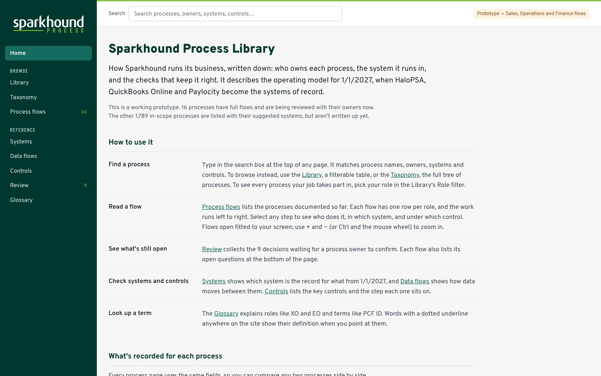

## What it's for

- **One answer to "how do we do this?"** Every process has a named owner, a system of record and, for the core processes, a step-by-step flow showing who does what.
- **Moving to the new systems.** The flows describe how work runs in Halo, QuickBooks Online, Paylocity and HubSpot from 1/1/2027, so teams can train and configure against the same picture.
- **Controls and SOC 2.** Key controls sit on the exact flow step where they happen, and Sparkhound's SOC 2 controls are linked to the processes they support, so an auditor's question can be traced to a process, an owner and evidence.
- **Decisions in one place.** Decisions waiting for a process owner's sign-off are flagged on the flow and gathered on the Review page.

## How it's organized

Processes are numbered by the **APQC Process Classification Framework (PCF) Cross-Industry v8.0**, a standard catalog of business processes. Levels go from category (1.0 Develop Vision and Strategy … 13.0 Develop and Manage Business Capabilities) down to activities, for example **9.2.2 Invoice customer**. Processes that APQC doesn't break out, such as onboarding a managed services client, are added under the nearest APQC parent with an `.S1`, `.S2`… suffix and a **Sparkhound** tag.

The library is meant to cover every Sparkhound process over time. Documentation started with the core processes for selling, delivering and billing work, and more are added as they are written up and reviewed with their owners.

Each process has a **status**: Not Started, Draft, **In Review** (a flow exists and is being confirmed with its owner), Published or Needs Update.

## How to use it

### Search
The search box at the top of every page matches process names, owners, systems and controls, and shows the results in the Library.

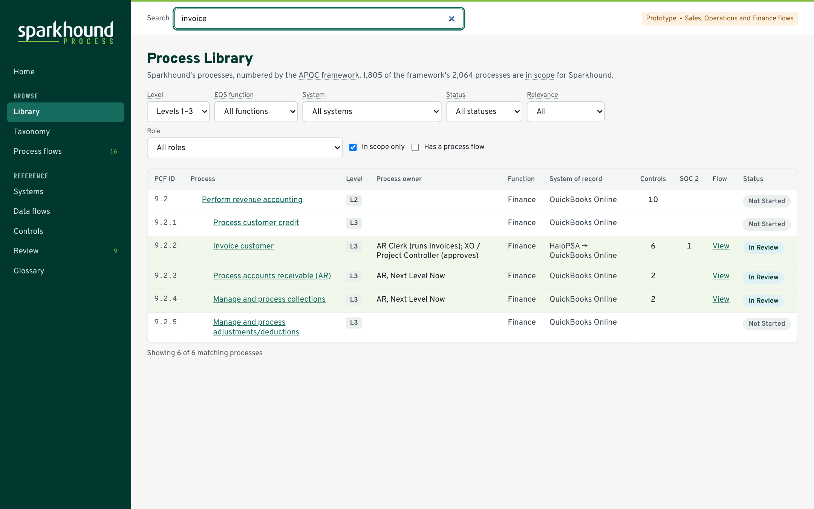

### Library
A filterable table of every process. Filter by level, EOS function, system, status, relevance and **role**: pick your role (for example XO, Partner, AR Clerk or Practice lead) to see every process your job takes part in. Tick **Has a process flow** to see only the documented ones.

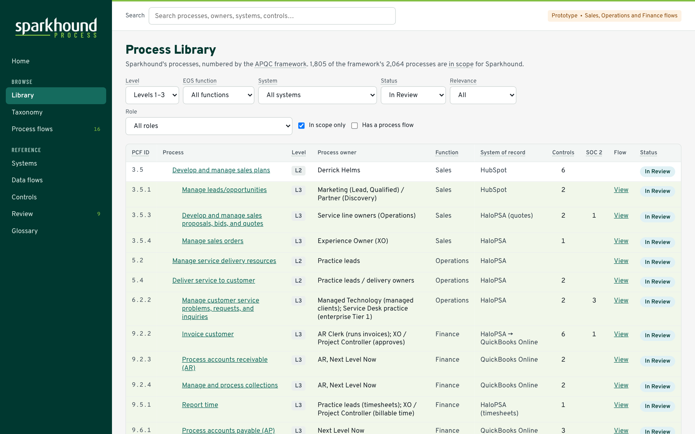

### Taxonomy
The full APQC tree, category by category, for browsing rather than searching.

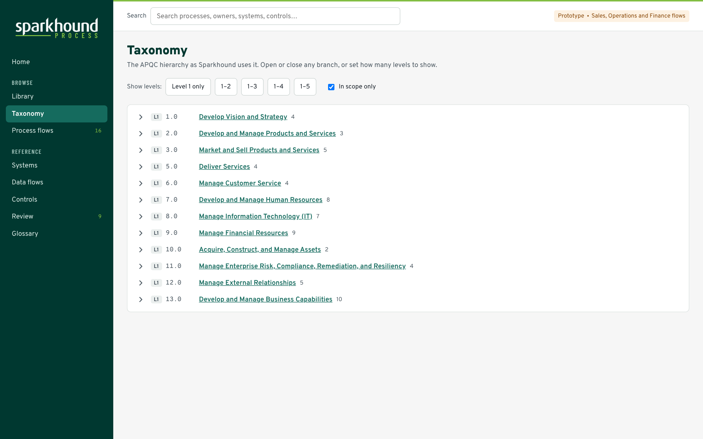

### Process flows
Every process that has a documented flow, with a link to each.

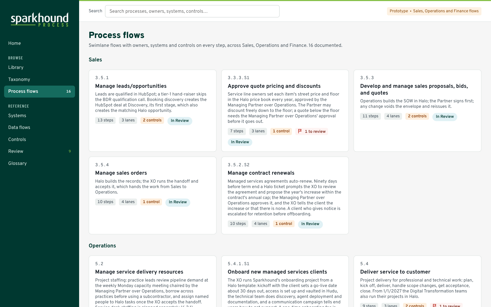

### A process page
Each process page shows its owner, accountable leader, function, system of record, linked processes and controls. Where a flow exists it's drawn as a swimlane diagram: one row per role, work running left to right.

- **Select any step** to open its details beside the flow: who does it, in which system, the control on it, and what comes next.
- **Zoom** with + and − (or Ctrl and the mouse wheel); **Fit to width** fits the whole flow on screen.
- **How to read this flow** explains the shapes: start/end pills, process steps, decisions, documents, control points (orange border), assumptions still to confirm (dashed) and steps flagged for owner review (red flag).
- **Upstream** and **hands off to** links move to the processes before and after.
- Open questions for the owner are listed at the bottom of draft flows.

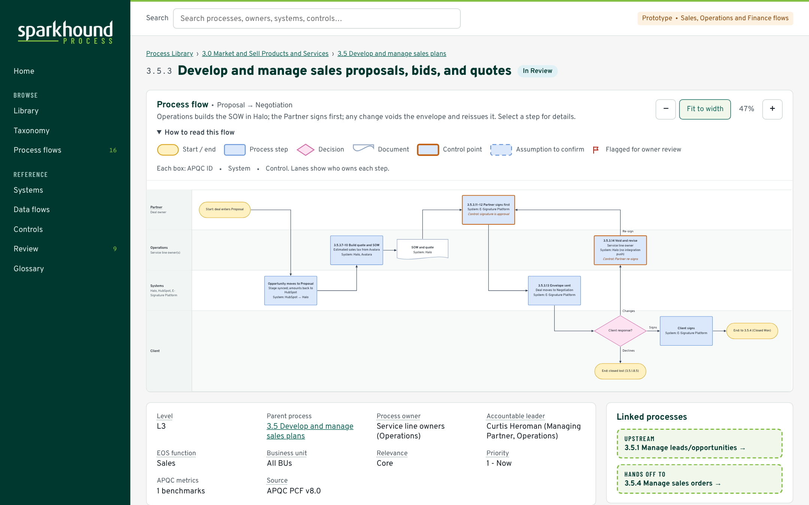

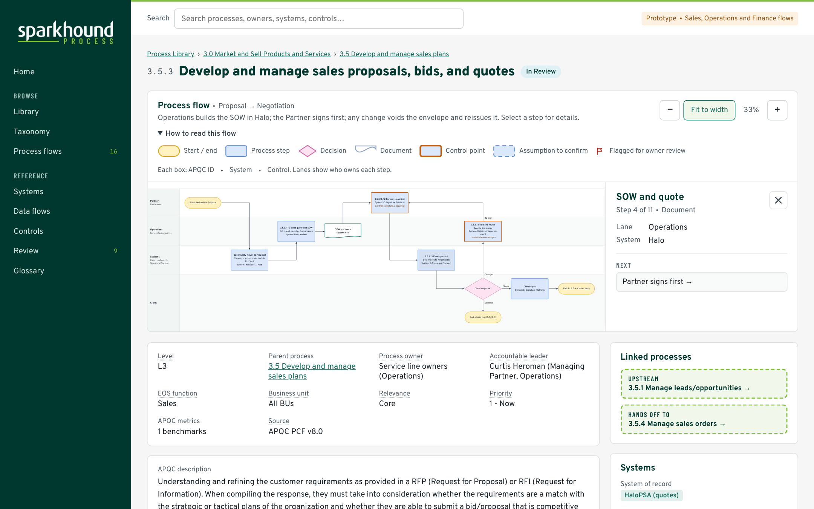

### Systems
The systems of record for 1/1/2027: each one's role, how many in-scope processes it's the system of record or a supporting system for, and notes. Select a system to see its processes. Systems still mapped in the workbook but not on the 1/1/2027 list are shown separately for confirmation.

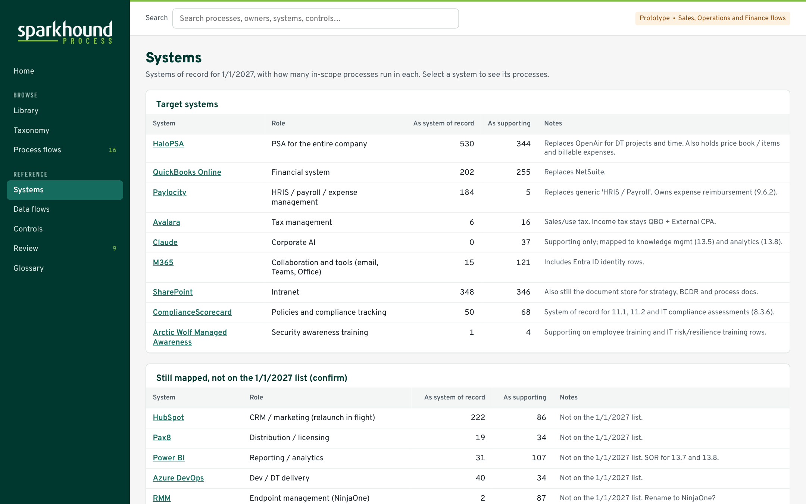

### Data flows
A diagram of how data moves between systems, with HaloPSA at the centre. Each numbered line matches a row in the table below it: what data moves, how (native, custom or planned integration), when, and which processes depend on it. Select a system to see only its flows. Solid lines are live integrations, dashed lines are planned, dotted lines are manual; a dotted box is a planned system and a dashed grey box is outside Sparkhound.

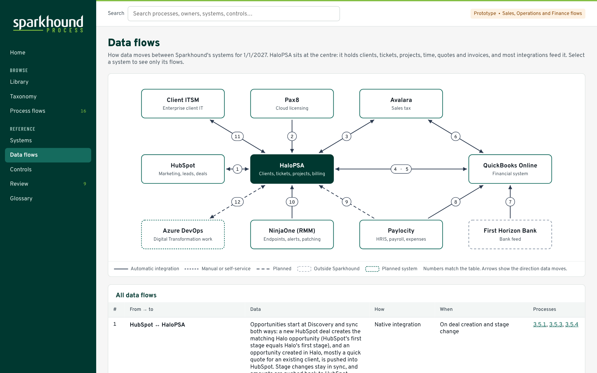

### Controls
The key controls built into the flows (ID, what it checks, the step it sits on, owner, system and evidence), followed by Sparkhound's SOC 2 controls by domain and the processes each one supports.

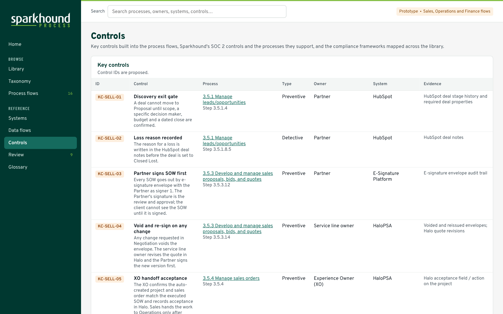

### Review
Everything waiting on a process owner: decisions flagged in the design sessions and open questions on draft flows. Each item links to its step.

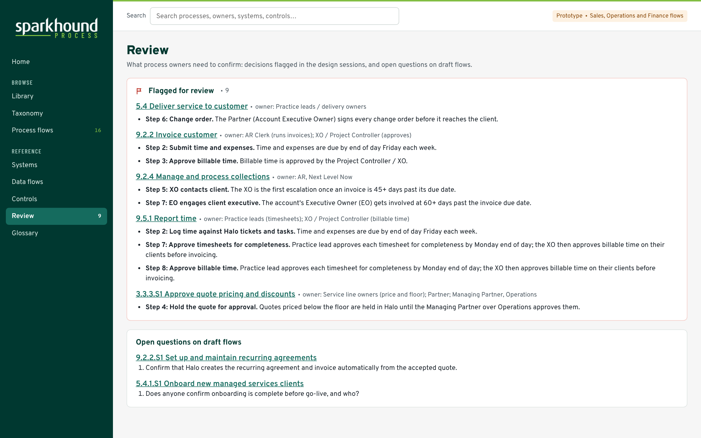

### Glossary
Roles and terms used across the site, such as **XO** (Experience Owner, the client relationship owner), **EO** (Executive Owner), **Partner** (the Sparkhound deal owner) and **PCF ID**. Words with a dotted underline anywhere on the site show their definition when you point at them.

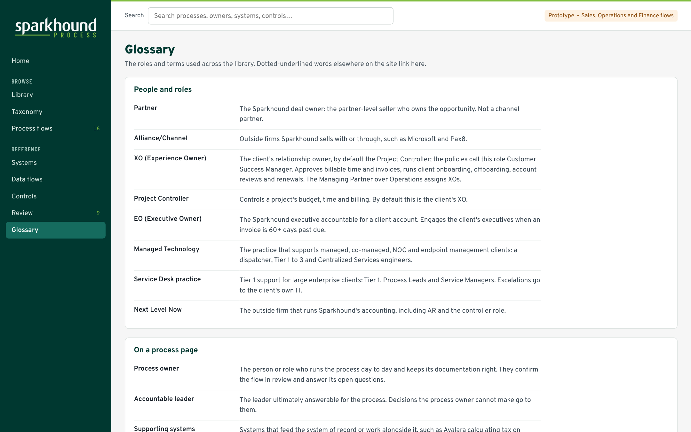

### Linking
Every page has its own address, so you can share a link straight to it: `#library`, `#flows`, `#dataflow`, `#controls`, `#review`, and `#p-<id>` for a process with dots as hyphens (for example `#p-9-2-2` for 9.2.2, `#p-5-4-1-S1` for 5.4.1.S1).

## How content gets updated

- **Processes, owners, systems and status** come from the workbook `source/Sparkhound_Process_Framework.xlsx`.
- **Flows, key controls and data flows** are maintained in `site/data/flows.json` and `site/data/dataflows.json`.
- **SOC 2 controls** are imported from the SOC 2 Master Control Matrix.
- Changes go through review with the process owner; flagged decisions stay on the Review page until the owner confirms them.

Details for maintainers are below and in `CLAUDE.md`.

---

# Maintaining and deploying the site

## Repo layout

| Path | What it is |
|---|---|
| `site/` | The website: `index.html`, `app.js`, `styles.css`. No build step. |
| `site/data/processes.json`, `systems.json` | Generated from the workbook. Don't edit by hand. |
| `site/data/flows.json` | Process flows and key controls. Edited by hand. |
| `site/data/dataflows.json` | Systems and the data flows between them, drawn on the Data flows page. Edited by hand. |
| `docs/screenshots/` | Screenshots used in this README. |
| `site/data/soc2.json` | SOC 2 controls and the processes they support. Generated by `scripts/build_soc2.py` from the SOC 2 Master Control Matrix. |
| `site/staticwebapp.config.json` | Sign-in, access rules and security headers. |
| `source/Sparkhound_Process_Framework.xlsx` | The process framework workbook, the source of truth for processes, owners and systems. |
| `scripts/build_data.py` | Rebuilds `processes.json` and `systems.json` from the workbook. |
| `.github/workflows/deploy.yml` | Rebuilds the data and deploys on every push to `main`. |

## Updating content

- **Processes, owners, systems, status:** edit the workbook's category tabs (1.0–13.0) and commit it to `source/`. The deploy rebuilds the data.
- **Process flows and controls:** edit `site/data/flows.json`. Each step has a `type` (start, end, process, decision, document), a `lane`, a `col` (left-to-right position), an optional `row` (second row within a lane), and `next` arrows with `from` / `toSide` sides (top, right, bottom, left).
- **Preview locally:** `python scripts/build_data.py source/Sparkhound_Process_Framework.xlsx site/data`, then `cd site && python -m http.server 8000` and open http://localhost:8000.

## One-time setup

### 1. Create the Static Web App (Azure portal)
1. Create a resource: **Static Web App**.
2. Plan: **Standard** (needed for custom Entra ID sign-in).
3. Deployment source: **GitHub**. Pick this repo and the `main` branch.
4. Build presets: **Custom**. App location `site`, API location empty, output location empty.
5. Azure adds the `AZURE_STATIC_WEB_APPS_API_TOKEN` secret to the repo. If it creates its own workflow file, delete it and keep `.github/workflows/deploy.yml`.

### 2. Register the app in Entra ID
1. Entra admin center → App registrations → **New registration**.
2. Name: `Process Library`. Supported account types: **Accounts in this organizational directory only**.
3. Redirect URI (Web): `https://process.sparkhound.com/.auth/login/aad/callback`. Also add the default `https://<app-name>.azurestaticapps.net/.auth/login/aad/callback`.
4. Authentication: enable **ID tokens**.
5. Certificates & secrets: create a **client secret** and copy its value.
6. Copy the **Application (client) ID** and **Directory (tenant) ID**.
7. Optional, to limit access to specific people: Enterprise applications → Process Library → Properties → **Assignment required = Yes**, then assign a group (for example, All Employees).

### 3. Connect sign-in
1. In `site/staticwebapp.config.json`, replace `<SPARKHOUND_TENANT_ID>` with the tenant ID and commit.
2. Static Web App → **Environment variables**: add `AZURE_CLIENT_ID` (the client ID) and `AZURE_CLIENT_SECRET` (the secret value).
3. Put a reminder on the calendar for the secret's expiry date.

### 4. Custom domain
1. Static Web App → **Custom domains** → Add → `process.sparkhound.com`.
2. In Sparkhound's DNS, create a **CNAME** record: `process` → `<app-name>.azurestaticapps.net`.
3. Azure validates the record and issues the HTTPS certificate automatically.

### 5. SharePoint
Add **process.sparkhound.com** to the intranet as a link (navigation, Quick Links or a button). An embedded iframe is not recommended: Microsoft's sign-in page cannot load inside a frame, and browsers increasingly block the cookies an embedded, signed-in site needs.

## Signing out
Visit `/logout`.
